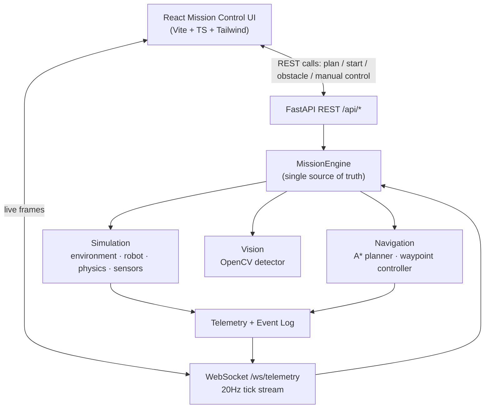
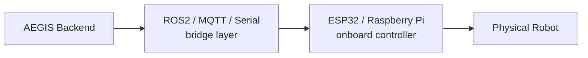

# AEGIS

**Autonomous Robotics Command & Simulation Platform**

AEGIS is a full-stack mission-control system for operating a simulated autonomous rover: a real 2D physics/sensor simulation, A* path planning with live dynamic-obstacle replanning, a WebSocket telemetry pipeline, and a computer-vision detection pipeline, all wrapped in a mission-control-style UI.

This is a simulation-first project, architected so the same navigation/vision modules can later be pointed at a physical robot (see [Future Hardware Integration](#future-hardware-integration)).

**This repository also includes two related security projects**, added as extensions of the same robotics/simulation/AI interests:
- **`backend/security/` + `backend/api/security_routes.py`** — a cybersecurity layer bolted onto the robot simulation: simulated attacks (sensor spoofing, unauthorized commands, replay, MITM, malicious nav injection, DoS) against the robot's command/telemetry channel, real defensive countermeasures (HMAC authentication, integrity/freshness checks, anomaly detection, rate limiting), and a quantified unsecured-vs-secured comparison (detection rate, false positives, response time, navigation degradation). Exposed in the frontend as the **Security (ARES)** page, and in the API at `/api/security/*`.
- **`backend/cyberrange/` + `backend/api/cyberrange_routes.py`** — an abstracted red-team/blue-team cyber range: configure a target system's hardening, launch a red-team technique campaign (port scan, brute force, privilege escalation, lateral movement, etc.) or defend against an assigned vulnerability (trojan, backdoor, time bomb, worm, rootkit) as blue team, with scored outcomes and a session notetaker. **All attacks/vulnerabilities here are abstract probabilistic models over data — there is no real exploit code, malware, or network attack tooling anywhere in this project.** Exposed as the **Cyber Range** page, and at `/api/cyberrange/*`.
- **`phishing-detector/`** — a separate, standalone project: an explainable phishing-URL detector (rule-based → logistic regression → random forest → neural network) with a feature-contribution explanation layer, a Chrome extension, a model-comparison dashboard, and its own README documenting methodology and results (including a genuine robustness gap found during evaluation — see `phishing-detector/README.md`).

---

## Overview

Open AEGIS, enter Mission Control, pick an environment, click a destination, and press **Plan Route** — the backend runs a real A* search over an occupancy grid and returns an optimal path. Press **Start Autonomous Mission** and the rover drives itself along the route using a heading/speed controller, streaming live telemetry over a WebSocket. Drop an obstacle onto its route mid-mission and the sensor system detects it, invalidates the path, and the planner computes a genuine detour in real time — visible in the event log as `OBSTACLE DETECTED → PATH INVALIDATED → REPLANNING... → NEW ROUTE CONFIRMED`.

Nothing here is a scripted animation. Every control calls a real backend endpoint, and every displayed number comes from the live simulation state.

## Features

- **Real A\* path planning** over a configurable occupancy grid, with path simplification, length/time/waypoint metrics, and sub-20ms planning times on the default grid size
- **Live dynamic obstacle avoidance**: place an obstacle during an active mission and watch the robot detect, invalidate, and replan around it
- **Robot finite-state machine** (`IDLE → PLANNING → NAVIGATING → OBSTACLE_DETECTED → REPLANNING → ... → MISSION_COMPLETE`, plus `PAUSED`, `EMERGENCY_STOP`, `FAULT`) with illegal transitions rejected at the model layer
- **Simulated sensor suite**: raycast LiDAR (configurable range/ray count/noise), 4-directional ultrasonic, noisy GPS, and IMU (heading/angular velocity/acceleration)
- **Real-time WebSocket telemetry** at 20Hz: position, heading, velocity, battery, sensor readings, and event log entries streamed to every connected client
- **Manual drive mode** with keyboard controls (WASD + Space) that cancels any active autonomous mission
- **Emergency stop** that halts the robot and requires an explicit operator reset before autonomous movement can resume
- **Computer vision pipeline** (OpenCV-based detector, architected for a drop-in YOLO swap) that processes either an uploaded image or a live rendered frame of the simulation and returns real bounding boxes, labels, confidence, and inference time
- **4 environment presets** (Open Field, Warehouse, Maze, Urban Grid) with genuinely different obstacle layouts
- **Live telemetry charts** (velocity, battery, heading, nearest-obstacle distance) and a filterable event log with severity levels
- **Diagnostics page** with real frontend FPS, backend/WebSocket latency, and simulation tick rate

## Architecture



### Backend layout

```text
backend/
├── main.py                 # FastAPI app, CORS, WS route, background tick loop
├── api/routes.py           # All REST endpoints (mission, environment, sensors, vision, diagnostics)
├── websocket/manager.py     # Connection manager + fixed-tick broadcast loop
├── simulation/
│   ├── environment.py      # Occupancy grid + continuous obstacle circles
│   ├── robot.py            # Pose, state machine, battery model
│   ├── physics.py          # Bounded-turn-rate / bounded-accel kinematic integrator
│   ├── sensors.py          # LiDAR raycasting, ultrasonic, GPS, IMU simulation
│   └── engine.py           # MissionEngine: ties everything into one tick loop
├── navigation/
│   ├── astar.py            # 8-connected A* with octile heuristic + corner-cut prevention
│   ├── planner.py          # World-space wrapper, metrics, route-blocked detection
│   └── controller.py       # Heading/speed waypoint controller
├── vision/
│   ├── detector.py         # OpenCV contour/color detector (YOLO-swap-ready interface)
│   └── preprocessing.py    # Frame decode/resize + simulated top-down camera renderer
├── models/schemas.py        # Pydantic request/response/telemetry models
└── tests/                   # 22 pytest cases across astar, collision, state machine, replanning
```

### Frontend layout

```text
frontend/src/
├── components/              # StatusBadge, Panel, Button, RobotStatus, MissionControls,
│                             # NavigationPanel, EmergencyStop, EventLog, SystemHealth,
│                             # SensorPanel, VisionDetectionPanel, TopBar, Sidebar
├── pages/                    # One page per sidebar section + Landing
├── simulation/SimulationCanvas.tsx   # Canvas renderer: grid, obstacles, path, rover, sensor rays
├── telemetry/TelemetryChart.tsx      # Recharts wrapper used across telemetry views
├── hooks/useTelemetryStream.ts       # WebSocket connection + reconnect + rolling history buffer
├── services/api.ts           # REST client
└── types/                     # TypeScript types mirroring the backend Pydantic schemas
```

## Technology Stack

**Frontend:** React, TypeScript, Vite, Tailwind CSS v4, Recharts, Lucide icons, HTML Canvas for the simulation view.

**Backend:** Python, FastAPI, native WebSockets, Pydantic v2, pytest.

## Robotics Algorithms

- **A\* search** on an 8-connected grid with an octile-distance heuristic (admissible and consistent for 8-connected movement, so the returned path is optimal on the grid). Diagonal moves that would cut across a blocked corner are explicitly disallowed.
- **Obstacle inflation**: obstacles are rasterized onto the grid with a small inflation margin beyond their physical radius, so the planner never returns a path that grazes an obstacle's true boundary (see the case study below for why this matters).
- **Path simplification** collapses collinear runs of grid cells into corner waypoints, so the controller isn't stopping-and-checking at every single 0.5m grid cell.
- **Waypoint controller**: a P-dominant heading controller with a distance/turn-angle-based speed governor — the robot slows sharply before a sharp turn and accelerates on straightaways, rather than running at constant speed and overshooting waypoints.
- **Kinematic integration**: bounded turn-rate and bounded-acceleration Euler integration with hard-stop-on-collision, rather than free continuous motion that could clip through obstacles.

## Sensor Simulation

| Sensor | Model |
|---|---|
| LiDAR | Configurable ray count/range/noise; each ray is raycast-marched against the obstacle field and world bounds |
| Ultrasonic | Four fixed-direction (front/left/right/rear) raycasts with light Gaussian noise |
| GPS | Ground truth position + Gaussian position noise + reported accuracy radius |
| IMU | Heading, angular velocity (derived from heading delta / dt), and acceleration, each with small Gaussian noise |

## Computer Vision

The Vision page runs frames — either an uploaded image or a rendered top-down frame of the live simulation — through `vision/detector.py`. The active backend is a lightweight OpenCV color/contour detector: it thresholds in HSV space to find colored obstacle markers, falls back to Canny-edge blob detection for frames without strong color signal, and returns real bounding boxes, per-detection confidence, and measured inference time (typically 5–15ms on a CPU).

This is deliberately the same `Detector.detect(frame) -> VisionResult` interface a real YOLO/ultralytics backend would expose, so swapping in a trained model or a remote inference service only touches `vision/detector.py` — no caller anywhere else in the codebase needs to change. That's the extension point for a future upgrade to an actual object-detection model once labeled training data or a hardware camera feed exists.

## Real-Time Communication

The frontend opens a single WebSocket to `/ws/telemetry` on load. A backend background task ticks the simulation at a fixed 20Hz, advancing physics, sensors, and the state machine, then broadcasts a JSON telemetry frame (position, heading, velocity, battery, full sensor frame, and any new event-log entries) to every connected client. The frontend keeps a rolling 200-frame history buffer for the telemetry charts and reconnects automatically (1.5s backoff) if the socket drops. Mission and environment mutations (destination, plan, start/pause/abort, manual control, obstacle placement) go over REST so they get normal request/response semantics and error handling, while all of them operate on the same shared `MissionEngine` instance the tick loop reads from — there's exactly one source of truth for simulation state.

## Engineering Challenges & Failure Investigation

**The failure mode this system is explicitly designed to avoid: replanning oscillation.**

A naive version of this pipeline is a well-known trap in mobile robotics: obstacle detection triggers a raw A* replan the instant an obstacle cell overlaps the active path, using the obstacle's exact physical radius as the only clearance margin, and a controller that drives at constant speed regardless of upcoming turn angle. Three things compound:

1. **Insufficient obstacle inflation.** If the grid only marks cells inside the obstacle's literal radius as blocked, A* will happily return a path that runs tangent to the obstacle's edge. The robot's own physical radius then makes that path unsafe in continuous space even though it was "valid" on the grid.
2. **Controller overshoot.** A controller with no speed governor drives at max speed into a waypoint, overshoots the arrival radius because it couldn't turn fast enough, and the geometry briefly looks like the robot has drifted off the "valid" side of the path — right next to the obstacle it just skirted.
3. **No replan cooldown.** With no minimum interval between replans, the system replans again immediately, computes a new tangent path on the other side of the obstacle, overshoots that one too, and the robot oscillates between two paper-thin "valid" routes hugging the obstacle boundary instead of making progress.

**Root cause:** the three failure points reinforce each other — thin clearance margins make marginal paths *look* optimal to A* (they're shorter), which is exactly the geometry a speed-unaware controller is worst at tracking precisely.

**Solution implemented (see `simulation/environment.py::_rasterize_obstacle` and `navigation/controller.py::WaypointController.compute`):**
- Obstacles are rasterized with a `0.35m` inflation margin beyond their physical radius, so A* is structurally prevented from returning a path that hugs an obstacle's true boundary — the shortest grid-valid path is now also a path with real clearance.
- The waypoint controller computes a `turn_penalty` from heading error and slows the target speed sharply before sharp turns, so the robot can actually track the planned path instead of overshooting waypoints near obstacle edges.
- `MissionEngine._maybe_trigger_replan` enforces a `REPLAN_COOLDOWN_S = 0.75s` minimum interval between replans, so transient sensor noise or a single momentary overlap can't trigger a replan storm even if the first two mitigations were somehow insufficient.

**Result:** with all three mitigations in place, the replanning test suite (`tests/test_replanning.py`) confirms the planner reliably finds a longer detour around a newly-placed obstacle rather than a marginal tangent path, and live testing of the full mission flow (destination → plan → start → inject obstacle → replan → arrive) completes in a single clean replan rather than oscillating.

**Lessons learned:** in a system with multiple layers that each individually look "reasonable" (a correct A* implementation, a correct-looking obstacle model, a controller that follows waypoints), the interaction between layers is where the real bugs live. Inflating the obstacle model by a small margin is cheap and looks like a rounding detail, but it's what actually keeps the planner from generating marginal geometry the controller can't safely track — the fix belongs in the shared world model, not just tuned away in the controller.

## Testing

Backend: 33 pytest cases across six files (A*, collision, state machine, replanning, security, cyberrange) —

```bash
cd backend
pip install -r requirements.txt --break-system-packages   # or use a venv
pytest tests/ -v
```

Covers: A* correctness (straight paths, blocked goals, wall avoidance, corner-cutting prevention, path simplification), collision detection (open space, obstacles, out-of-bounds, grid rasterization, kinematic collision stop), the robot state machine (legal/illegal transitions, full happy-path sequence, emergency-stop reset requirement), and the planner/replanning logic (successful plans, unreachable goals, blocked-path detection, and confirming a live replan produces a genuine detour).

## Running Locally

**Backend:**
```bash
cd backend
python3 -m venv .venv && source .venv/bin/activate   # optional but recommended
pip install -r requirements.txt
uvicorn main:app --reload --port 8000
```

**Frontend:**
```bash
cd frontend
npm install
cp .env.example .env   # points at http://localhost:8000 by default
npm run dev
```

Open the printed local URL, click **Enter Mission Control**, and you're operating the rover.

## Future Hardware Integration

AEGIS is simulation-first but architected so the navigation and vision modules can be pointed at a physical robot without a rewrite:



The intended integration points:
- `simulation/sensors.py`'s raycast/noise models would be replaced by a ROS2 subscriber node consuming real LiDAR/IMU/GPS topics, publishing into the same `SensorFrame` schema — the REST/WebSocket layer above it doesn't change.
- `navigation/controller.py`'s `ControlOutput` (target speed + target heading) is already the right shape to hand to a motor driver over serial or an MQTT topic instead of `simulation/physics.py`'s kinematic integrator.
- `vision/detector.py`'s `Detector.detect(frame) -> VisionResult` interface is unchanged whether `frame` comes from `render_simulated_frame` or a real camera feed grabbed via OpenCV's `VideoCapture` from an onboard Pi camera.

The goal of keeping these interfaces stable throughout the simulation build was so that a hardware port is a matter of swapping implementations behind existing interfaces, not redesigning the system.
